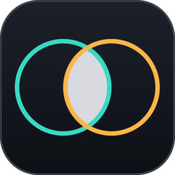
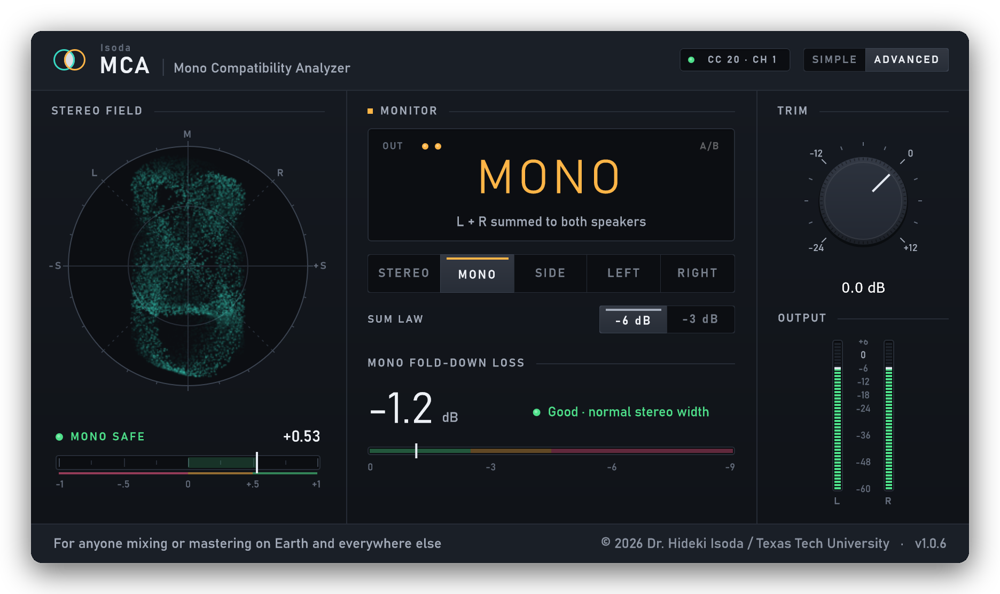
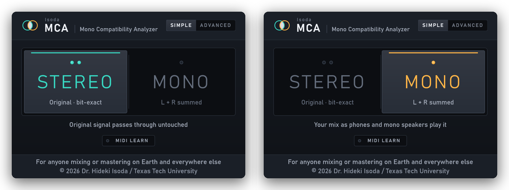
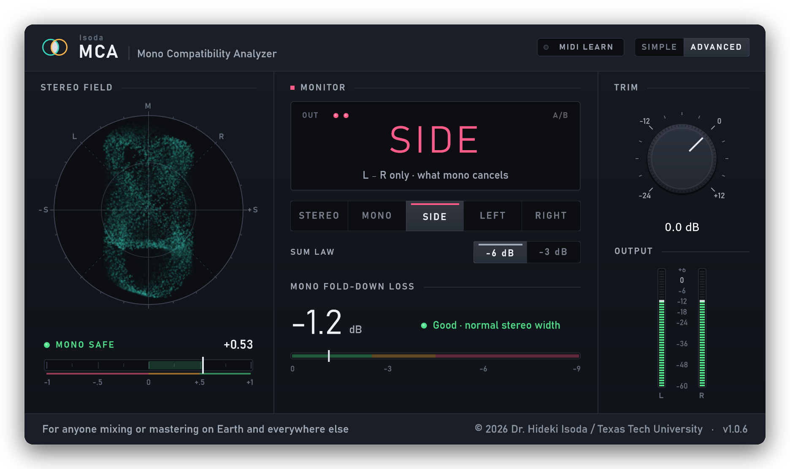

<p align="center">
  
</p>

<h1 align="center">Isoda MCA</h1>
<p align="center"><b>Mono Compatibility Analyzer</b><br>
<i>For anyone mixing or mastering on Earth and everywhere else</i></p>

<p align="center">
  <a href="https://github.com/hidekiisoda/isoda-mca/releases/tag/v1.0.6"><b>Download 1.0.6</b></a> ·
  <a href="#install-on-windows">Install on Windows</a> ·
  <a href="#install-on-macos">Install on macOS</a> ·
  <a href="#using-mca">Using MCA</a>
</p>

<p align="center">
  
</p>

**Isoda MCA is free plug-in software intended for precision, professional sound engineering work.** It folds your stereo mix to mono, the way phones, Bluetooth and smart speakers, club systems and mono broadcast will play it, and shows you exactly what that fold-down does to your mix.

Most listeners never hear your mix the way you do on studio monitors. A wide synth that sounds glorious in stereo can all but vanish on a phone speaker; a reverb return out of phase can hollow out a vocal on the radio. MCA lets you hear and measure that in a click, right on your master bus, before anyone else does.

MCA is a VST3 plug-in for Windows and a VST3 and Audio Unit plug-in for Macs with Apple silicon. In your DAW it appears as **MCA** by **Isoda**, in the *Analyzer* category.

## Download

| Platform | Package | Requirements |
|---|---|---|
| **Windows** | [Isoda-MCA-1.0.6-Windows-manual-install.zip](https://github.com/hidekiisoda/isoda-mca/releases/download/v1.0.6/Isoda-MCA-1.0.6-Windows-manual-install.zip) | 64-bit Windows 10 or 11, a VST3 host |
| **macOS** | [Isoda-MCA-1.0.6-macOS-manual-install.zip](https://github.com/hidekiisoda/isoda-mca/releases/download/v1.0.6/Isoda-MCA-1.0.6-macOS-manual-install.zip) | Mac with Apple silicon (M1 or later), macOS 11 or later, a VST3 or Audio Unit host |

Each package contains the plug-in, a step-by-step install guide, the Quick Start guide and the license. Installation takes about a minute; the steps are below.

## What it does

- **Stereo and Mono at a click.** Switch between your untouched stereo mix and its mono fold-down instantly, or click the big mode display for a quick A/B.
- **100% transparent in Stereo.** In Stereo, and whenever your DAW bypasses the plug-in, the audio passes through bit for bit. Not a single sample is altered, so MCA can live on your master bus permanently.
- **Five monitor modes.** Stereo, Mono (L+R), Side (L−R, everything that disappears in mono), Left and Right.
- **Measurement you can trust.** A goniometer for the stereo image, a phase-correlation meter, and a *mono fold-down loss* readout that tells you, in dB, how much energy the mix loses when summed.
- **Your choice of sum law.** −6 dB, which keeps centre-panned sources at the same level, or −3 dB for equal-power summing.
- **Monitor trim and output meters.** Level-match the mono fold-down by ear; the trim never touches the stereo signal.
- **Hands-free switching.** Assign any button, pad or knob on a MIDI controller with MIDI Learn, or map your DAW's own controller to the *Mono* parameter.
- **Two views.** *Advanced* shows everything; *Simple* is one large Stereo / Mono switch for quick checks and client sessions.

<p align="center">
  
</p>

## Install on Windows

1. **Remove an older version, if you have one.** If you used an earlier installer, uninstall it in *Settings → Apps → Installed apps*. Otherwise delete any older `ISODA MCA.vst3` folder from `C:\Program Files\Common Files\VST3\`.
2. **Unblock the download.** Right-click the ZIP → **Properties** → tick **Unblock** at the bottom of the *General* tab → **OK**. Do this *before* extracting, so Windows doesn't flag every file inside.
3. **Extract and copy.** Right-click the ZIP → **Extract All…**, then copy the **`Isoda MCA.vst3`** folder into `C:\Program Files\Common Files\VST3\`. Click **Continue** when Windows asks for administrator permission.
4. **Rescan plug-ins** in your DAW (see [Finding MCA in your DAW](#finding-mca-in-your-daw)).

<details>
<summary><b>If Windows or your browser blocks it</b></summary>

MCA is free and isn't code-signed with a paid certificate, so Windows treats it as *unrecognized*. It contains no network code and collects no data.

| What you see | What to do |
|---|---|
| **Edge:** "…isn't commonly downloaded" | Hover over the download, click **…** → **Keep** → **Show more** → **Keep anyway**. |
| **Chrome:** "Suspicious download" | Click **Keep** in the downloads list. |
| Your antivirus quarantines the files | Restore them and add an exception for the `Isoda MCA.vst3` folder. |
| **Smart App Control** (Windows 11): your DAW lists MCA as failed, or doesn't show it after a rescan | Smart App Control can refuse unsigned plug-ins and has no override. The only way around it is to switch it off under *Windows Security → App & browser control → Smart App Control settings*. On many Windows 11 versions it can't be switched back on without resetting Windows, so weigh that before you do it. |

</details>

## Install on macOS

macOS marks anything downloaded from the internet with a *quarantine* flag. MCA isn't notarized with a paid Apple Developer ID, so the flag has to be removed from the plug-in files before your DAW will load them. One Terminal command does that for these files only; Gatekeeper stays on for everything else.

1. **Unzip** the download: double-click it, if Safari hasn't already. You'll get a folder named `Isoda-MCA-1.0.6-macOS-manual-install` in Downloads.
2. **Open Terminal**: press ⌘-Space, type *Terminal*, press Return.
3. Type `cd ` (with a space), **drag the unzipped folder** from Finder into the Terminal window, and press Return.
4. **Paste these lines** and press Return:

   ```bash
   xattr -dr com.apple.quarantine .
   rm -rf ~/Library/Audio/Plug-Ins/VST3/"ISODA MCA.vst3" ~/Library/Audio/Plug-Ins/Components/"ISODA MCA.component"
   mkdir -p ~/Library/Audio/Plug-Ins/VST3 ~/Library/Audio/Plug-Ins/Components
   cp -R "Isoda MCA.vst3" ~/Library/Audio/Plug-Ins/VST3/
   cp -R "Isoda MCA.component" ~/Library/Audio/Plug-Ins/Components/
   killall -9 AudioComponentRegistrar 2>/dev/null; echo "Done"
   ```

   The first line removes the quarantine flag. The second removes an older version if you had one. The next three copy the VST3 and the Audio Unit into your own plug-in folders (no administrator password needed). The last makes macOS register the new Audio Unit straight away.
5. **Rescan plug-ins** in your DAW (see below).

<details>
<summary><b>If a DAW says the plug-in "is damaged" or "can't be opened"</b></summary>

Clear the flag on the installed copies and re-apply the local signature that every Apple silicon plug-in needs, then restart the DAW:

```bash
xattr -dr com.apple.quarantine ~/Library/Audio/Plug-Ins/VST3/"Isoda MCA.vst3" ~/Library/Audio/Plug-Ins/Components/"Isoda MCA.component"
codesign --force --deep -s - ~/Library/Audio/Plug-Ins/VST3/"Isoda MCA.vst3" ~/Library/Audio/Plug-Ins/Components/"Isoda MCA.component"
```

If you installed an earlier version with the `.pkg` installer, also delete the old copies in `/Library/Audio/Plug-Ins/VST3` and `/Library/Audio/Plug-Ins/Components` (Finder → Go → Go to Folder…).
</details>

## Finding MCA in your DAW

MCA is listed as **MCA** by **Isoda**, in the *Analyzer* category. If it doesn't appear, rescan your plug-ins:

| DAW | How to rescan |
|---|---|
| **Cubase / Nuendo** | Studio → VST Plug-in Manager → Rescan all. If MCA is listed as blocklisted, select it and click **Reactivate**. |
| **Logic Pro** | Logic Pro → Settings → Plug-in Manager. If MCA shows *failed*, select it and click **Reset & Rescan Selection**. Insert it from an Audio FX slot → Audio Units → Isoda → MCA. |
| **GarageBand** | Settings → Audio/MIDI → tick **Enable Audio Units**. |
| **Ableton Live** | Settings → Plug-Ins → turn on the VST3 system folder (and Audio Units on a Mac) → **Rescan**. |
| **FL Studio** | Options → Manage plugins → **Find installed plugins**. |
| **Reaper** | Settings → Plug-ins → VST → **Re-scan**. |
| **Studio One** | Settings → Locations → VST Plug-Ins → **Reset Blocklist**, then restart. |
| **Bitwig** | Settings → Locations; Bitwig rescans on start. |

## Using MCA

Insert MCA as the **last plug-in on your master bus**, after your limiter and meters, so that it only changes what you hear. Click **MONO** to hear the fold-down and **STEREO** to return. Stereo is bit-exact, so the plug-in can stay in place; still, it's good practice to switch back to Stereo before you export.

<p align="center">
  
</p>

### Monitor modes

| Mode | What you hear | Use it to… |
|---|---|---|
| **Stereo** | Your mix, untouched | Reference |
| **Mono** | (L + R) on both speakers | Hear the mix as phones, clubs and mono broadcast play it |
| **Side** | (L − R) only | Hear exactly what *disappears* in mono: wide synths, reverbs, out-of-phase elements |
| **Left / Right** | One channel on both speakers | Check each side on its own, or pick the clean channel of a dual-mic recording |

### Reading the meters

- **Stereo field (goniometer).** A vertical line means mono; a wide cloud means wide stereo; a horizontal shape means out-of-phase content that will cancel. The display zooms to fit the signal, so its *size* shows the shape of the image, not the loudness. Hover over it for a reminder.
- **Phase correlation.** +1 means the channels are identical; above +0.5 is mono safe; between 0 and +0.5 is wide (check that the important parts survive); below 0 means parts of the mix will cancel in mono.
- **Mono fold-down loss.** How much energy the mix loses when summed: 0 dB loses nothing, about −3 dB is typical of very wide material, and anything below −4.5 dB usually points to a phase problem worth investigating.

### Switching from a MIDI controller

- **MIDI Learn:** click **MIDI LEARN**, then press a button or pad, or move a knob. *Toggle* (the default) switches on every press; *Follow* means Mono while the control is held or above its midpoint. MCA reads the controller directly, so no MIDI routing is needed, and the assignment is saved with your project.
- **Your DAW's own mapping:** MCA has an on/off parameter called **Mono**. Map it with Cubase's MIDI Remote or Quick Controls, Ableton's MIDI Map, Logic's Controller Assignments or Reaper's Learn.

### Pulling narration out of a video's stereo audio

MCA is just as useful in post-production. Put it on the dialogue or production track in your DAW, or in a video editor that hosts VST3 plug-ins (DaVinci Resolve, Premiere Pro, VEGAS Pro and others), then render with the mode you need:

- **Voice recorded on one channel**, say a lavalier on the left and the camera mic on the right: **Left** or **Right** takes the clean channel and puts it on both speakers. The correlation meter tells you which case you have: two different mics read low, while a dual-mono copy reads +1.
- **Voice in the centre over stereo music:** **Mono** keeps the centred voice at full level while wide music, reverb and ambience partly cancel.
- **The opposite, a voice-free bed:** **Side** removes whatever sits in the centre and leaves the wide parts of the mix.

MCA works with stereo placement; it isn't an AI voice separator. It works best when the voice is centred or has a channel of its own.

## Privacy

MCA collects no data. It makes no network connections, has no analytics or telemetry, and needs no account, registration or license key. It listens to your MIDI controllers only on your own computer, for the MIDI switch. Its settings are stored in your DAW project, nowhere else.

## License

Isoda MCA is **freeware**: free for personal, educational and commercial use on any number of computers. You're welcome to share the unmodified packages with anyone, free of charge, with the license and copyright notice intact. It is not open source. The full terms are in [LICENSE.txt](LICENSE.txt).

Built with the [JUCE](https://juce.com) framework. VST is a registered trademark of Steinberg Media Technologies GmbH; Audio Units is a trademark of Apple Inc. The macOS version embeds the Barlow typeface (SIL Open Font License 1.1).

## About

Isoda MCA is made by **Dr. Hideki Isoda** at **Texas Tech University**. Questions, ideas and reports from your own sessions are very welcome; please open an [issue](https://github.com/hidekiisoda/isoda-mca/issues).

<sub>© 2026 Dr. Hideki Isoda / Texas Tech University</sub>
